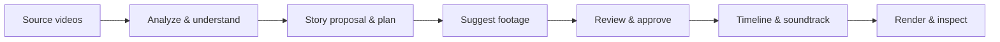

# Video Edit Agent

A local-first AI-assisted editor for personal video projects. Analyze footage, develop a story, build a reviewable edit plan, and render only after approval. Source media is never modified.

## Quickstart

### Docker (Ollama)

Requirements: Docker Compose and a project folder containing video files.

```bash
cp .env.example .env
docker compose up -d ollama
docker compose exec ollama ollama pull qwen2.5vl:3b
docker compose exec ollama ollama pull qwen2.5:1.5b
docker compose run --rm -it video-agent create-video ./my-video \
  --prompt "Create a concise, cinematic personal video"
```

For the full workflow, configuration, hosted soundtrack providers, and review steps, see [the feature guide](docs/feature-guide.md).

### Native Python

Requirements: Python 3.11, 3.12, or 3.13, FFmpeg/ffprobe, and Ollama (unless using an MLX provider).

```bash
python3 -m venv .venv
source .venv/bin/activate
python -m pip install -e ".[dev,transcription]"
cp .env.example .env
set -a && source .env && set +a
ollama pull qwen2.5vl:3b
ollama pull qwen2.5:1.5b
video-agent --help
video-agent create-video ./my-video \
  --prompt "Create a concise, cinematic personal video"
```

For Apple Silicon MLX vision, install `.[mlx,dev]` in a native macOS environment and choose `--provider mlx` or `--provider qwen3-vl`. See [Qwen3-VL setup](docs/qwen3-vl.md).

## Video decoding and scene detection

Scene detection uses PySceneDetect's **PyAV backend** by default. PyAV uses FFmpeg's decoding libraries and enables automatic decoder threading. If PyAV cannot open a particular video, the application logs a warning and retries with the OpenCV backend.

PyAV is installed as a regular project dependency, so the standard editable install and Docker image build include it. After pulling a change that adds or updates dependencies, rebuild the API image:

```bash
docker compose build web-api
docker compose up -d web-api
```

A local benchmark on a 138.137-second MOV clip measured the following full scene-detection times with the same PySceneDetect content threshold and minimum scene duration:

| Backend | Detection time |
| --- | ---: |
| OpenCV | 1,253.70 seconds |
| PyAV (automatic threading) | 359.35 seconds |

That is approximately **3.49× faster** with PyAV on this particular clip. Both backends returned the same interval, 0.000–138.137 seconds. The clip produced only one detected scene, so this result demonstrates a performance improvement for the tested file, not comprehensive scene-boundary accuracy across footage with multiple cuts. Performance varies with codec, resolution, frame rate, hardware, and source media.

## Command overview

- **Ingest & understand:** `analyze`, `understand`, `transcribe`, `detect-silence`, `propose-edits`, `review-edits`, `build-timeline`, `subtitles`
- **Story & planning:** `find-highlights`, `create-video`, `plan`, `create-plan`, `propose-story`, `select-story`, `suggest-footage`, `approve-storyboard`, `build-storyboard-timeline`, `review-storyboard`, `review-footage`
- **Editing & revisions:** `draft-edit`, `optimize-timeline`, `review-timeline`, `review-timeline-visual`, `apply-timeline-visual-edits`, `revise-timeline`, `review-timeline-revision`, `compare-timelines`
- **Rendering & visual review:** `render`, `render-social-exports`, `style-presets`, `init-title-overlays`, `suggest-title-sequences`, `review-title-overlays`, `render-revision-preview`, `render-draft`, `critique-draft`, `suggest-revisions`, `review-revision-suggestions`, `compare-drafts`
- **Soundtrack & music:** `suggest-soundtrack`, `search-soundtrack`, `generate-soundtrack`, `prepare-soundtrack-candidates`, `review-soundtrack`, `select-soundtrack`, `analyze-selected-soundtrack`, `analyze-music`, `suggest-music-sync`, `review-music-timeline`, `review-music-sync`
- **Project maintenance:** `validate-artifacts`, `clean`, `report-revision-cycle`

Run `video-agent --help` for per-command options.

## Pipeline



## Project layout

- `src/video_edit_agent/` — canonical Python package.
- `src/travel_video_agent/` — compatibility shim for older imports.
- `docs/` — architecture, model setup, feature guides, maintainer notes, and release instructions.
- `.video-agent/` — project-local analysis, plans, review decisions, and generated outputs.

The distribution and CLI are named `video-edit-agent` / `video-agent`; the canonical Python import is `video_edit_agent`. The legacy `travel_video_agent` namespace remains available as a compatibility shim.
