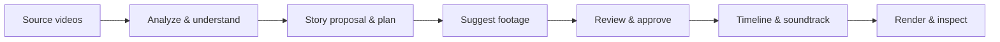

# Video Edit Agent

A local-first AI-assisted editor for personal video projects. Analyze footage, develop a story, build a reviewable edit plan, and render only after approval. Source media is never modified.

## Quickstart

### Docker (Ollama)

Requirements: Docker Compose and a project folder containing video files.

```bash
cp .env.example .env
docker compose up -d ollama
docker compose exec ollama ollama pull qwen2.5vl:3b
docker compose run --rm video-agent analyze ./my-video
docker compose run --rm video-agent understand ./my-video
docker compose run --rm video-agent create-plan ./my-video --prompt "A concise, cinematic personal video"
docker compose run --rm video-agent suggest-footage ./my-video
```

For the full workflow, configuration, hosted soundtrack providers, and review steps, see [the feature guide](docs/feature-guide.md).

### Native Python

Requirements: Python 3.11 or 3.12, FFmpeg/ffprobe, and Ollama (unless using an MLX provider).

```bash
python3 -m venv .venv
source .venv/bin/activate
python -m pip install -e ".[dev,transcription]"
video-agent --help
video-agent analyze ./my-video
video-agent understand ./my-video
```

For Apple Silicon MLX vision, install `.[mlx,dev]` in a native macOS environment and choose `--provider mlx` or `--provider qwen3-vl`. See [Qwen3-VL setup](docs/qwen3-vl.md).

## Command overview

| Area | Commands |
|---|---|
| Ingest & understand | `analyze`, `understand`, `transcribe`, `detect-silence` |
| Story & planning | `find-highlights`, `propose-story`, `select-story`, `create-plan`, `suggest-footage`, `review-storyboard` |
| Editing & timeline | `propose-edits`, `review-edits`, `build-timeline`, `plan`, `draft-edit`, `optimize-timeline`, `review-timeline`, `revise-timeline` |
| Rendering & review | `render`, `render-draft`, `critique-draft`, `compare-drafts`, `subtitles`, `init-title-overlays`, `review-title-overlays` |
| Soundtrack & music | `suggest-soundtrack`, `search-soundtrack`, `generate-soundtrack`, `analyze-music`, `suggest-music-sync`, `review-music-sync` |
| Project maintenance | `validate-artifacts`, `clean`, `report-revision-cycle` |

Run `video-agent --help` for the complete list and per-command options.

## Pipeline



## Project layout

- `src/travel_video_agent/` — Python import namespace (retained for compatibility).
- `docs/` — architecture, model setup, feature guides, and operational notes.
- `.video-agent/` — project-local analysis, plans, review decisions, and generated outputs.

The distribution and CLI are named `video-edit-agent` / `video-agent`; the Python import namespace remains `travel_video_agent` to avoid breaking existing integrations.
